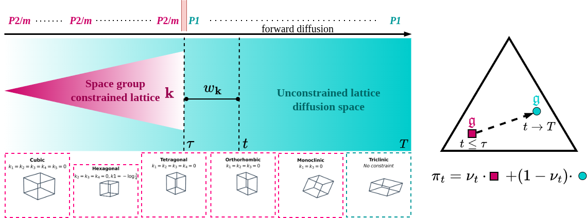

# [Symmetry-Breaking De Novo Crystal Generation via Markovian Jump Diffusion](https://arxiv.org/abs/2608.13457)
#### Authors: [Van Khoa Nguyen](https://scholar.google.com/citations?user=UDVkJKcAAAAJ&hl=en&authuser=1), [Alexandros Kalousis](https://scholar.google.com/citations?hl=en&user=uVkn9UEAAAAJ&view_op=list_works&sortby=pubdate)

## Abstract
Generating crystals has recently attracted significant interest due to their broad applications in materials science. However, existing generative models struggle to produce complete crystallographic specifications, limiting their ability to capture global symmetry and structural dependencies. In particular, current state-of-the-art approaches generate crystals only up to site symmetries and rely on sampling space groups from empirical distributions during generation. Inspired by *spontaneous symmetry breaking* in physics, where crystals break symmetries under external conditions, we propose a novel diffusion-based framework that generates full structure specifications by reversing from the lowest-symmetry priors. Our method leverages a Markovian jump-diffusion process to model these symmetry-breaking dynamics, enabling it to traverse different space groups in a physically motivated manner. Our model, dubbed *Symmetry-breaking Crystal Diffusion* (SbCD), introduces a principled approach to explicitly incorporate inter-space-group transitions into the generative process. In de novo generation experiments on MP20 and MPTS-52, SbCD outperforms its symmetry-preserving counterpart by a substantial margin, offering a promising perspective for generative modeling of crystalline materials.

<p align="center">
  
</p>

## Installation

From the repository root, create the Conda environment defined in `sbcd.yml`.

```sh
conda env create -f sbcd.yml
```

Activate the environment using the name specified in `sbcd.yml`.

## Running SbCD

Run all commands from the repository root. Use `run_mp20.sh` for MP-20 and `run_mpts52.sh` for MPTS-52. The `-t` option selects the task. For training, `-e` takes an experiment name. For the remaining tasks, `-e` takes the absolute path to the experiment directory.

### Training

```sh
sh run_mp20.sh -t train -e mp20_v0
sh run_mpts52.sh -t train -e mpts52_v0
```

### Sampling

Use a model you trained or download our best released checkpoints so far ([link](https://drive.google.com/file/d/1sUu8mGWKn6GPS46wQgmGhQy9J4GRAXrE/view?usp=sharing)). Place each downloaded experiment directory under `_ckpts/` and point `-e` to the directory containing the checkpoint and its saved configuration.

```sh
sh run_mp20.sh -t sampling -e "$PWD/_ckpts/mp20_v0"
sh run_mpts52.sh -t sampling -e "$PWD/_ckpts/mpts52_v0"
```

### Pre-relaxation with CHGNet

```sh
sh run_mp20.sh -t prelax -e "$PWD/_ckpts/mp20_v0"
sh run_mpts52.sh -t prelax -e "$PWD/_ckpts/mpts52_v0"
```

### Energy above the convex hull

Download the Materials Project convex hull snapshot dated **2023-02-07** ([link](https://drive.google.com/file/d/11Vz9WD-p7b9OmbjqrNu_3yCXP0qiv_5J/view?usp=sharing)) and place it in the SbCD repository root before running this step.

```sh
sh run_mp20.sh -t ehull -e "$PWD/_ckpts/mp20_v0"
sh run_mpts52.sh -t ehull -e "$PWD/_ckpts/mpts52_v0"
```

### S.U.N. metrics

```sh
sh run_mp20.sh -t sun -e "$PWD/_ckpts/mp20_v0"
sh run_mpts52.sh -t sun -e "$PWD/_ckpts/mpts52_v0"
```

## Acknowledgements

SbCD builds on the following open-source codebases:

- [DiffCSP++](https://github.com/jiaor17/DiffCSP-PP)
- [SymmCD](https://github.com/sibasmarak/SymmCD)
- [MiAD](https://github.com/andrey-okhotin/miad)

We thank the authors and contributors for making their code publicly available.

## Citation

If you find SbCD useful in your research, please consider citing our paper. We also appreciate your support in sharing our work with the community.

```bibtex
@article{nguyen2026symmetry,
  title={Symmetry-Breaking De Novo Crystal Generation via Markovian Jump Diffusion},
  author={Nguyen, Van Khoa and Kalousis, Alexandros},
  journal={arXiv preprint arXiv:2608.13457},
  year={2026}
}
```